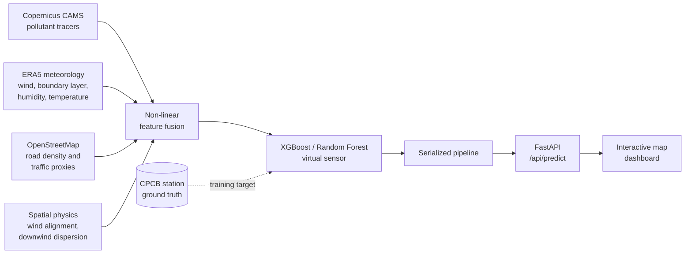

# 🌫️ Hyper-Local AI Air Quality Index (AQI) Virtual Sensing Engine

> Estimate real-time AQI at **any coordinate in Vidarbha, India**, even where no physical monitoring station exists, using machine learning on satellite, weather, and road-traffic proxies.

[](https://ai-aqi-estimator.onrender.com/)


🔗 **Live app:** https://ai-aqi-estimator.onrender.com/
> The app is hosted on Render's free tier, so the first load may take ~30–60 seconds to wake up.

---

## 📌 TL;DR (for recruiters)

| | |
|---|---|
| **Problem** | Government air-quality stations (CPCB/MPCB) are expensive and sparse, so most semi-urban and rural areas have no AQI data. |
| **Solution** | A machine-learning "virtual sensor" that predicts the official India NAQI at any lat/lon by learning the gap between coarse satellite estimates and real ground-station readings. |
| **Result** | **R² = 0.727**, **MAE = 16.6 AQI points** on a held-out, chronologically split test set, significantly outperforming linear baselines. |
| **Delivered** | End-to-end pipeline (ingestion → feature engineering → training → validation → serialized model) plus a **FastAPI backend** and an **interactive map dashboard**, deployed live. |

**Skills demonstrated:** data engineering and API ingestion · geospatial feature engineering · handling skewed data · leakage-free time-series validation · gradient-boosted tree modeling and tuning · model serialization · REST API design · cloud deployment.

---

## 🎯 The Problem

Air pollution is a major public-health issue in India, yet monitoring coverage is thin. In the Vidarbha region (Nagpur, Chandrapur, Amravati, Akola) only a handful of physical CPCB/MPCB stations exist.

- Areas **without a station** have no reliable ground truth.
- **Satellite reanalysis data** (Copernicus CAMS, ~5 × 5 km grid) is available everywhere, but it is too coarse to capture local spikes from traffic, road dust, industry and power-plant plumes.
- **Simple interpolation** (e.g. Inverse Distance Weighting) assumes pollution decays linearly with distance, which is physically wrong.

## 💡 The Solution

Instead of predicting pollution from scratch, the model learns a **correction function**:

> *"When CAMS says X, the weather looks like Y, and the surrounding roads look like Z, what does a real CPCB ground station actually measure?"*

Once trained, this function can be applied at **any coordinate**, because every input feature is freely available worldwide without a physical sensor.



---

## ✨ Key Features

- **Coordinate-based inference.** Click anywhere on the map (or enter lat/lon) and get an estimated AQI with a health category.
- **Official India NAQI.** Computed with the CPCB methodology: the maximum sub-index across PM2.5, PM10, NO₂, SO₂, CO and O₃.
- **Feature fusion beyond raw sensors.** Combines sparse station data with local proxies: wind vectors, boundary-layer dynamics and live road-traffic/infrastructure indicators.
- **Leakage-free validation.** Chronological data splitting so the model never trains on the future.
- **Spatial generalization testing.** Leave-One-Station-Out (LOSO) evaluation to check how the model transfers to a city it has never seen.
- **Production-ready artifact.** The best model is serialized (`joblib`) into a self-contained pipeline for instant inference.
- **Live dashboard.** City cards for Nagpur, Chandrapur, Amravati and Akola, an AQI scale and health guidance, and a satellite HCHO / biomass-burning hotspot view.

---

## 📊 Results

| Metric | Value |
|---|---|
| **R² score** | **0.727** |
| **MAE** | **16.6 AQI points** |
| Best models | XGBoost and Random Forest (hyperparameter-tuned) |
| Baselines | Linear models and IDW spatial interpolation (outperformed) |

> NAQI categories: 0–50 Good · 51–100 Satisfactory · 101–200 Moderate · 201–300 Poor · 301–400 Very Poor · 401–500 Severe.
> An average error of ~16.6 points means a prediction usually lands in the correct or an adjacent category.

---

## 🧠 Methodology

### 1. Data sources
| Role | Source | Details |
|---|---|---|
| Target (ground truth) | **CPCB / MPCB stations** (via WAQI and OpenAQ archives) | Real hourly readings from 4 stations: Nagpur, Chandrapur, Amravati, Akola |
| Feature: air chemistry | **Copernicus CAMS** (via Open-Meteo) | PM2.5, PM10, NO₂, SO₂, CO, O₃ at ~5 km |
| Feature: meteorology | **ECMWF ERA5** (via Open-Meteo) | Wind speed/direction, temperature, humidity, pressure, boundary-layer dynamics |
| Feature: infrastructure | **OpenStreetMap (Overpass API)** | Road density, highway counts, intersections |
| Feature: physics | Computed | Haversine distance, wind alignment, downwind dispersion vectors |

### 2. Feature engineering
- Wind speed/direction decomposed into **vector components**.
- **Cyclic encodings** for hour-of-day, day-of-week and season.
- **Combustion tracer ratios** between pollutants.
- **Non-linear feature fusion** of station data with local proxies.

### 3. Handling skewed data
AQI values are strongly **right-skewed** (a few very high pollution episodes dominate the tail). The pipeline uses skew-aware transformations and tree-based models that are robust to non-Gaussian targets.

### 4. Leakage-free splitting
Data is split **chronologically** (train → validation → test in time order) rather than randomly, preventing temporal leakage from adjacent hours. LOSO splits additionally test generalization to unseen stations.

### 5. Modeling
Tuned **XGBoost** and **Random Forest** regressors (LightGBM was also benchmarked) against linear baselines and an IDW interpolation baseline.

### 6. Deployment
The champion model is packaged into one serialized pipeline (`joblib`), served by a **FastAPI** microservice, and consumed by a web dashboard hosted on **Render**.

---

## 🏗️ Repository Structure

```
major_project/
├── ml/                      # Pipeline: ingestion → preprocessing → merge → split → train → validate → serialize
├── ds/                      # Data-science support code and satellite data handling
├── backend/                 # FastAPI service + static web dashboard
├── AQI_project.ipynb        # Exploratory analysis and modeling notebook
├── colab_notebook.ipynb     # Colab-ready training notebook
├── PROJECT_HANDBOOK.md      # Detailed technical documentation
├── project_knowledge_base.md# Design decisions log
├── requirements.txt         # Python dependencies
└── run.py                   # App entry point
```

---

## 🚀 Run Locally

```bash
# 1. Clone
git clone https://github.com/Shivanand-0/major_project.git
cd major_project

# 2. (Recommended) create a virtual environment
python -m venv venv
source venv/bin/activate        # Windows: venv\Scripts\activate

# 3. Install dependencies
pip install -r requirements.txt

# 4. Start the app
python run.py
```

Then open **http://localhost:8000** for the dashboard and **http://localhost:8000/docs** for interactive API docs (Swagger).

### API endpoints
| Endpoint | Purpose |
|---|---|
| `GET /api/nodes` | Monitoring stations / city nodes |
| `GET /api/predict?lat=..&lon=..` | Estimated NAQI at a coordinate |
| `GET /api/grid` | Regional grid of estimates for the map |

> Re-training from scratch needs a free [WAQI API token](https://aqicn.org/data-platform/token/) set as the `WAQI_TOKEN` environment variable.

---

## ⚠️ Limitations & Future Work

- Trained on **4 stations in one region**; accuracy outside Vidarbha is untested.
- Performance is lower at **extreme pollution peaks**, which are rare in the data.
- Planned improvements: more stations and a longer time span, SHAP-based explainability, an hourly forecast mode, and automated retraining with scheduled live data.

---

## 🛠️ Tech Stack

**Language:** Python  
**ML:** XGBoost, Random Forest, LightGBM, scikit-learn, NumPy, pandas, SciPy  
**Geospatial / data:** NetCDF4, h5py, Haversine & wind-physics features, OpenStreetMap  
**Backend:** FastAPI, Uvicorn, Pydantic, httpx  
**Frontend:** Interactive map dashboard (HTML/JS)  
**Deployment:** Render

---

## 👤 Author

**Shivanand Gupta**  
B.Tech, Computer Science (Data Science), Shri Ramdeobaba College of Engineering and Management, Nagpur (2027)

- GitHub: [@Shivanand-0](https://github.com/Shivanand-0)
- LinkedIn: _add your link_
- Email: _add your email_

---

*If you find this project interesting, a ⭐ on the repo is appreciated!*
