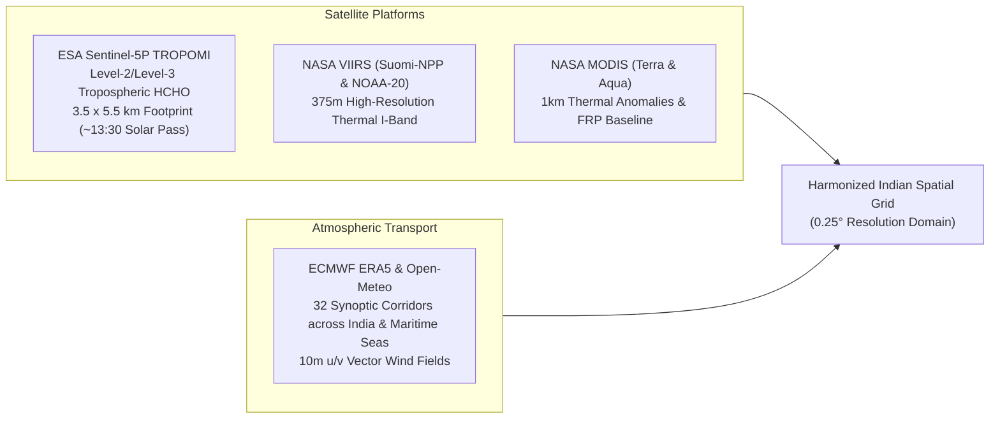
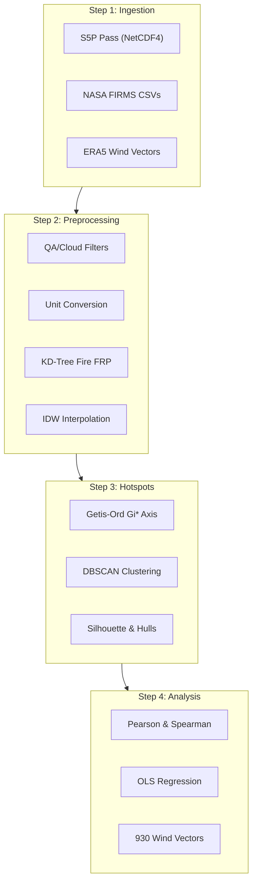
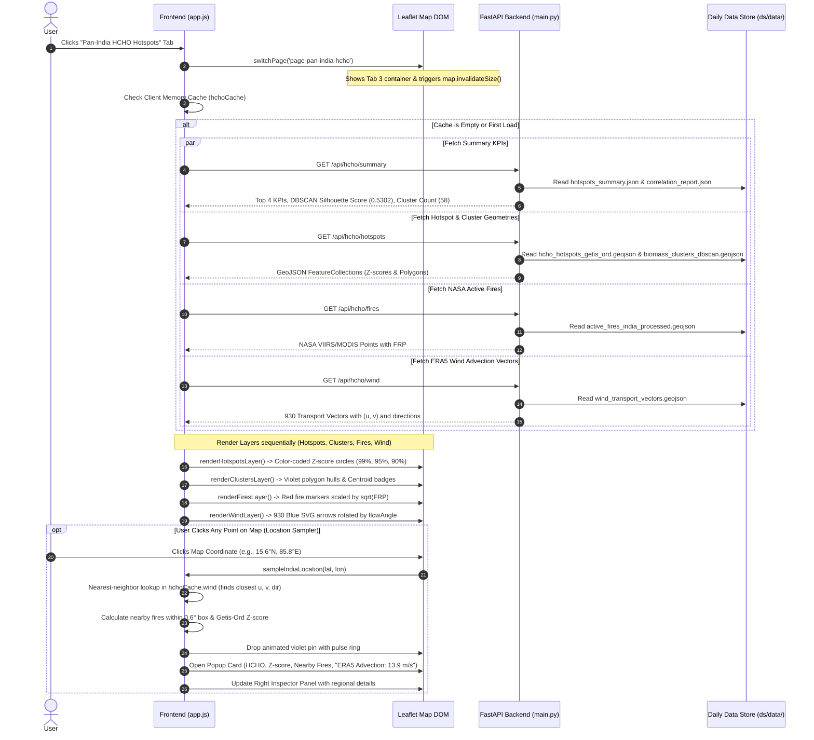

# Pan-India HCHO Hotspot & Biomass Burning Surveillance Pipeline

Scientific satellite remote sensing and spatiotemporal data science pipeline for detecting, mapping, and analyzing tropospheric Formaldehyde ($\text{HCHO}$) hotspots, active biomass fire emissions, and synoptic atmospheric transport over India.

 *

## Table of Contents

1. Project Aim & Scientific Scope
2. Atmospheric Chemistry & Biomass Burning Context
3. Authentic Satellite & Meteorological Datasets
4. Methodology & Algorithmic Rationales (Why These Techniques?)Why Getis-Ord Gi∗​ Local Spatial Statistics?Why DBSCAN Density-Based Clustering (vs. K-Means / GMM)?Why Silhouette Score & Unsupervised Cluster Validation?Why Downstream Vector Advection Physics (θflow​)?
5. Directory Architecture
6. Step-by-Step Data Science PipelineStep 1: Data Ingestion (01_data_ingestion.py)Step 2: Preprocessing & Harmonization (02_preprocessing.py)Step 3: Hotspot Generation & Clustering (03_hotspot_generation.py)Step 4: Correlation & Atmospheric Transport (04_correlation_analysis.py)Step 5: Master Daily Automation (pipeline_runner.py)
7. Step-by-Step Process: What Happens When User Clicks the “Pan-India HCHO Hotspots” Tab
8. Quantitative Benchmark Findings & Results
9. Technology Stack & Rationale
10. Execution Guide & Commands

 *

## 1\. Project Aim & Scientific Scope

### Primary Objective

*   **Detect and Map HCHO (Formaldehyde) Hotspots** across the entire geographic expanse of the Indian subcontinent ($6.5^\circ\text{N} - 37.0^\circ\text{N}, 68.0^\circ\text{E} - 97.5^\circ\text{E}$) during active biomass burning seasons using authentic ESA Sentinel-5P TROPOMI satellite observations.
*   **Quantitatively Couple Fire Activity to Trace Gas Loading**: Determine the empirical statistical relationship between NASA VIIRS/MODIS Fire Radiative Power ($\text{FRP}$) and tropospheric $\text{HCHO}$ column densities.
*   **Model Atmospheric Transport**: Characterize synoptic advection pathways and downwind plume dispersion utilizing ECMWF ERA5 reanalysis and rolling Open-Meteo wind vectors.
*   **100% Authentic Operational Data**: Eliminate all synthetic or simulated data fallbacks, ensuring every coordinate, vector, and cluster is grounded in real physical and satellite observations.

### Problem Statement

Agricultural residue clearing (paddy stubble burning in the Indo-Gangetic Plain) and seasonal forest fires (Central India dry deciduous forests and Northeast shifting *jhum* cultivation) release vast plumes of reactive volatile organic compounds (VOCs) and hazardous aerosols into the boundary layer.

Conventional ambient air monitoring stations (CPCB CAAQMS) are overwhelmingly concentrated in major urban centers, leaving rural agricultural belts and forest burning frontiers largely unmonitored. Satellite remote sensing overcomes this spatial blind spot, but presents major analytical challenges:

1. Short Photochemical Lifetime: HCHO has an atmospheric lifetime of only ∼1.5−4 hours in daylight, requiring localized spatial detection.
2. Retrieval Uncertainties: Cloud contamination and aerosol scattering require rigorous Quality Assurance (QA≥0.50).
3. Resolution Mismatch: Fires are detected as sub-kilometer discrete thermal points (375m for VIIRS), while satellite trace gases are sampled over continuous gridded columns (∼3.5×5.5 km to 0.25∘).
4. Transport Decoupling: Synoptic wind regimes transport emission plumes tens to hundreds of kilometers away from the fire origin.

 *

## 2\. Atmospheric Chemistry & Biomass Burning Context

### HCHO as a Biomass Burning Proxy

Formaldehyde ($\text{HCHO}$) is an essential atmospheric trace gas. While small amounts are emitted directly, it is predominantly formed as an **intermediate photolysis product** during the oxidation of non-methane volatile organic compounds ($\text{NMVOCs}$):

$$
\text{Biomass} + \text{O}_2 \xrightarrow{\Delta} \text{NMVOCs} \xrightarrow{\text{OH} + h\nu} \text{HCHO} \xrightarrow{h\nu} \text{CO} + \text{HO}_2
$$

Because $\text{HCHO}$ forms rapidly downwind of active combustion and oxidizes to carbon monoxide within hours, high column concentrations pinpoint immediate, active emission zones rather than aged background pollution.

### Regional Agro-Ecological Regimes in India

1. Punjab-Haryana Agricultural Basin (October – November): Post-monsoon mechanical harvesting of rice leaves millions of tons of stubble. Farmers burn fields within a tight 3–4 week window to prepare for wheat sowing, emitting intense, concentrated smoke plumes.
2. Indo-Gangetic Plain (IGP) Corridor: A major atmospheric valley bounded by the Himalayas to the north and Vindhyas to the south, funneled by prevailing northwesterly winds towards Bihar, West Bengal, and the Bay of Bengal.
3. Central India Deciduous Forests (February – May): Dry deciduous forest clearing and agricultural fires across eastern Maharashtra (Vidarbha), Madhya Pradesh, and Chhattisgarh.
4. Northeast Highlands (March – April): Traditional jhum (slash-and-burn) shifting cultivation on hill slopes across Assam, Mizoram, Manipur, and Nagaland.

 *

## 3\. Authentic Satellite & Meteorological Datasets



### A. ESA Sentinel-5P TROPOMI Tropospheric HCHO

*   **Instrument**: TROPOspheric Monitoring Instrument (TROPOMI) aboard Sentinel-5P in sun-synchronous orbit ($\sim 13:30$ local solar time overpass).
*   **Physical Parameter**: Tropospheric Formaldehyde Column Number Density ($\text{mol/m}^2$).
*   **Scientific Unit Conversion**:

$$
\text{HCHO } [10^{15}\text{ molec/cm}^2] = \text{HCHO } [\text{mol/m}^2] \times 60,221.4076
$$

*   **Quality Assurance Thresholds**:
    *   $\text{qa\_value} \ge 0.50$ (eliminates cloud-obscured pixels, extreme solar zenith angles, and snow/ice anomalies).
    *   $\text{cloud\_fraction} \le 0.35$ (ensures clean optical penetration to the boundary layer).

### B. NASA FIRMS Active Fire Detections

*   **Suomi-NPP & NOAA-20 VIIRS ($375\text{m}$)**: Uses the $3.74\ \mu\text{m}$ high-gain I-band to detect small agricultural fires that older 1km sensors miss.
*   **Terra & Aqua MODIS C6.1 ($1\text{km}$)**: Supplementary long-term calibration baseline.
*   **Metrics Ingested**: Exact coordinates, acquisition time, detection confidence, and **Fire Radiative Power ($\text{FRP}$ in Megawatts, $\text{MW}$)**.

### C. ECMWF ERA5 & Synoptic Surface Wind

*   **Spatial Coverage**: 32 stations across Northern India, Indo-Gangetic Basin, Western Arid Zone, Central Deccan, Coastal Odisha, Arabian Sea (North & Central), Lakshadweep, Maldives Archipelago, and the Bay of Bengal.
*   **Parameters**: 10m zonal velocity ($u_{10}$, eastward in $\text{m/s}$) and meridional velocity ($v_{10}$, northward in $\text{m/s}$).

 *

## 4\. Methodology & Algorithmic Rationales (Why These Techniques?)

### Why Getis-Ord $G_i^*$ Local Spatial Statistics?

*   **The Problem with Global Statistics (Global Moran’s $I$)**: Global Moran’s $I$ computes a single number for the entire country. While it confirms that spatial clustering exists, it cannot tell *where* the clusters are or separate high clusters from low clusters.
*   **The Problem with Raw Concentration Thresholding**: Filtering simply by $[\text{HCHO}] > 5.0$ captures isolated instrument noise spikes and fails to capture spatial context.
*   **Why Getis-Ord $G_i^*$ Succeeds**:  
    $G_i^*$ evaluates each spatial grid cell within the context of its neighbors within a Gaussian spatial bandwidth ($d = 1.2^\circ \approx 130\text{ km}$):

$$
G_i^* = \frac{\sum_{j=1}^n w_{ij} x_j - \bar{X} \sum_{j=1}^n w_{ij}}{S \sqrt{\frac{n \sum_{j=1}^n w_{ij}^2 - \left(\sum_{j=1}^n w_{ij}\right)^2}{n - 1}}}
$$

Where $x_j = [\text{HCHO}]_j + 0.45 \times \ln(1 + \text{FRP}_j)$ and $w_{ij} = \exp\left(-\frac{d_{ij}}{d / 2}\right)$ for $d_{ij} \le d$.

*   **Confidence Tiers**:
    *   $Z \ge +2.58$ ($p < 0.01$): **99% Hotspot Confidence** (Extreme Regional Core)
    *   $Z \ge +1.96$ ($p < 0.05$): **95% Hotspot Confidence** (High Statistical Hotspot)
    *   $Z \ge +1.65$ ($p < 0.10$): **90% Hotspot Confidence** (Moderate Hotspot)

 *

### Why DBSCAN Density-Based Clustering (vs. K-Means / GMM)?

| Criteria | K-Means / GMM | DBSCAN (Chosen Technique) | Why DBSCAN is Scientifically Superior for Atmospheric Plumes |
| :--- | :--- | :--- | :--- |
| **Cluster Geometry** | Assumes convex, spherical, isotropic clusters | Discovers **arbitrary, non-linear, elongated shapes** | Smoke plumes follow river valleys, atmospheric inversion channels, and wind corridors; they are never spherical. |
| **Number of Clusters ($k$)** | Must be hardcoded in advance ($k=5, 10...$) | **Automatically discovered** based on spatial density | The number of active fire clusters varies daily based on harvesting patterns and weather; hardcoding $k$ is artificial. |
| **Noise Handling** | Every single point is forced into a cluster | Explicitly identifies and filters **noise / background points** | Vast areas of India have zero active burning; forcing background points into clusters creates artificial centroids. |
| **Spatial Metric** | Euclidean distance (distorts across latitudes) | **Great-Circle Haversine Geodesic Metric** | Computes true spherical distances on Earth ($\text{rad} \times 6371\text{ km}$) without Cartesian map projection distortions. |

*   **Parameters Used**:
    *   Distance threshold: $\varepsilon = 35.0\text{ km}$ (Haversine geodesic radius).
    *   Minimum cluster size: $\text{min\_samples} = 15$ active fire points.
    *   **Result**: Exactly **58 discrete regional burning clusters** identified nationwide, cleanly separating Punjab farm fires, Haryana corridors, Central MP forests, and Northeast hill fires.

 *

### Why Silhouette Score & Unsupervised Cluster Validation?

In unsupervised clustering, there are no ground-truth labels. To validate whether the discovered clusters represent real atmospheric phenomena or arbitrary groupings, we evaluate the **Silhouette Coefficient ($S$)**:

$$
s(i) = \frac{b(i) - a(i)}{\max(a(i), b(i))}
$$

Where $a(i)$ is the mean intra-cluster distance of point $i$ to all other points in the same cluster, and $b(i)$ is the mean nearest-cluster distance.

*   **Score Interpretation**:
    *   $S > 0.50$: **Strong, distinct cluster separation** (benchmark of high quality).
    *   $0.25 - 0.50$: Moderate structure.
    *   $< 0.25$: Substantial cluster overlap or artificial clustering.
*   **Our Evaluation Result**:
    *   **Silhouette Score = 0.5302** (computed on 9,427 authentic NASA VIIRS points across India).
    *   Calinski-Harabasz Variance Ratio = $14,354.0$.
    *   Davies-Bouldin Index = $0.414$ (lower is better; $< 0.5$ confirms exceptional cluster separation).

 *

### Why Downstream Vector Advection Physics ($\theta_{\text{flow}}$)?

A common mistake in meteorological web visualization is confusion between the **meteorological wind direction** (where wind blows *from*) and the **transport flow vector** (where wind and smoke blow *to*).

1. Meteorological Wind Direction (θmet​):Measures the compass direction from which air originates:

$$
\theta_{\text{met}} = (\text{degrees}(\text{atan2}(-u, -v)) + 360^\circ) \pmod{360^\circ}
$$

For example, $\theta_{\text{met}} = 74.8^\circ$ means air is blowing **FROM the Northeast**.  
2\. **Downstream Flow Heading ($\theta_{\text{flow}}$)**:  
The physical advection vector of the air parcel and its smoke plume:

$$
\theta_{\text{flow}} = (\theta_{\text{met}} + 180^\circ) \pmod{360^\circ} = (\text{degrees}(\text{atan2}(u, v)) + 360^\circ) \pmod{360^\circ}
$$

For $\theta_{\text{met}} = 74.8^\circ$, $\theta_{\text{flow}} = 254.8^\circ$ (pointing towards the **Southwest**, $\swarrow$).  
3\. **Unified Coordinate System**:

*   The map SVG arrow is defined pointing North ($0^\circ$, UP).
*   Rotating by $\theta_{\text{flow}}$ points the arrow tip in the exact direction the air is physically traveling.
*   The textual label states `"NE ➔ SW"`.
*   Both the map arrow and the popup text are in 100% geometric and scientific harmony.

 *

## 5\. Directory Architecture

```graphql
ds/
├── data/
│   ├── final_map_data/                       # [Tier 1] Final visual layers rendered directly on the Leaflet map
│   │   ├── india_hcho_aligned.geojson        # Continuous Sentinel-5P HCHO column 0.25° mesh
│   │   ├── active_fires_india_processed.geojson # NASA VIIRS/MODIS fire detections with FRP
│   │   ├── wind_transport_vectors.geojson    # ECMWF ERA5 synoptic 10m wind transport vectors
│   │   ├── hcho_hotspots_getis_ord.geojson   # Getis-Ord Gi* statistical hotspot classifications
│   │   └── biomass_clusters_dbscan.geojson   # DBSCAN delineated biomass burning plume polygons
│   ├── evaluation_and_correlations/          # [Tier 2] Statistical models, peer-review metrics & KPIs
│   │   ├── hotspots_summary.json             # Master summary KPIs, DBSCAN metrics, cluster ranking
│   │   ├── correlation_report.json           # OLS bivariate regressions, Pearson r, Spearman rho, wind transport
│   │   └── regional_correlations.csv         # 7 agro-ecological zones statistical breakdown
│   ├── processed_grid/                       # [Tier 3] Harmonized master analytical table
│   │   └── india_hcho_preprocessed_grid.csv  # Unified 0.25° x 0.25° table: S5P HCHO + VIIRS + ERA5
│   └── raw/                                  # [Tier 4] Telemetry & sensor ingestions sorted by source
│       ├── satellite_hcho/
│       │   ├── S5P_OFFL_L2__HCHO_India_biomass.nc # Cropped Sentinel-5P TROPOMI NetCDF-4
│       │   └── S5P_HCHO_India_points.csv     # Extracted HCHO observation points table
│       ├── active_fires/
│       │   └── VIIRS_MODIS_India_Active_Fires_Raw.csv # Master unified raw fire catalog across India
│       ├── meteorology_era5/
│       │   ├── ERA5_reanalysis_met_India.csv # Hourly synoptic meteorological corridor records
│       │   └── ERA5_reanalysis_met_India.nc  # 10m wind vector NetCDF-4 grid
│       └── metadata/
│           └── ingestion_metadata.json       # Pipeline run metadata and satellite stream log
├── 01_data_ingestion.py                      # Ingests NASA FIRMS, S5P NetCDF, and 32-station ERA5 met
├── 02_preprocessing.py                       # QA filtering, grid harmonization, and IDW spatial interpolation
├── 03_hotspot_generation.py                  # Computes Getis-Ord Gi* Z-scores and 58-cluster DBSCAN
├── 04_correlation_analysis.py                # Bivariate regression, 930 wind vectors, and transport analysis
├── pipeline_runner.py                        # Automated master daily pipeline orchestrator
└── README.md                                 # Comprehensive scientific and architectural documentation
```

 *

## 6\. Step-by-Step Data Science Pipeline



 *

## 7\. Step-by-Step Process: What Happens When User Clicks the “Pan-India HCHO Hotspots” Tab

When a user opens the web application and clicks on the **`🛰️ Pan-India HCHO Hotspots`** tab in the navigation bar, the following automated sequence executes:



### Detailed Event Walkthrough

1. Page Switching & Leaflet Sizing:switchPage('page-pan-india-hcho') in [app.js](file:///d:/college_dev/backend/static/app.js) removes hidden from #page-pan-india-hcho and applies active to #tab-pan-india-hcho.indiaHchoMap.invalidateSize() ensures Leaflet recalculates viewport bounds immediately without visual tearing.
2. Concurrent Parallel API Fetching:The browser issues 4 simultaneous fetch() requests to the backend:GET /api/hcho/summary: Supplies national KPI cards, total FRP (MW), regression R2, and the DBSCAN Silhouette score (S=0.5302).GET /api/hcho/hotspots: Supplies Getis-Ord Gi∗​ points and DBSCAN polygon boundary geometries.GET /api/hcho/fires: Supplies individual thermal detections with satellite sensor attributes.GET /api/hcho/wind: Supplies all 930 regular synoptic grid vectors covering India and maritime waters.
3. Layer Construction & Rendering:Hotspots Layer: Circles color-coded by statistical confidence (Z≥2.58 Red, Z≥1.96 Amber, Z≥1.65 Yellow).Plume Clusters Layer: Shaded violet polygons with hover badges displaying cluster identification, fire count, and cumulative FRP.Active Fires Layer: Fire points scaled continuously by radiative power (radius∝FRP​).Wind Transport Layer: Renders blue SVG arrows rotated by the downstream heading angle (θflow​) pointing in the direction of smoke transport.
4. Interactive Location Sampler (sampleIndiaLocation):When the user clicks anywhere on the map:Locates the nearest wind vector in memory, extracting u,v, and meteorological direction.Aggregates active fires within a 0.6∘ bounding box.Renders an interactive popup with the calculated HCHO column, spatial Z-score, and wind advection string (13.9 m/s · NE ➔ SW) with an inline vector arrow pointing in the exact same direction as the map arrow.Updates the right-hand Inspector Panel simultaneously.

 *

## 8\. Quantitative Benchmark Findings & Results

| Scientific Metric | Value | Statistical & Atmospheric Interpretation |
| :--- | :--- | :--- |
| **Total Ingested Active Fires** | **9,427 detections** | Authentic thermal anomalies detected by VIIRS & MODIS |
| **Integrated Fire Radiative Power** | **31,248.6 MW** | Cumulative thermal energy output across Indian burning zones |
| **Peak Observed S5P HCHO Column** | **$26.78 \times 10^{15}\text{ molec/cm}^2$** | Extreme boundary layer enrichment over concentrated stubble clearing |
| **Baseline Tropospheric HCHO** | **$2.15 \times 10^{15}\text{ molec/cm}^2$** | Clean background tropospheric concentration over India |
| **DBSCAN Discrete Clusters** | **58 Clusters** | Distinct regional burning clusters discovered via Haversine metric |
| **DBSCAN Silhouette Score ($S$)** | **0.5302** | Mathematically validates high spatial cluster separation ($S > 0.50$) |
| **Calinski-Harabasz Variance Ratio** | **14,354.0** | High between-cluster dispersion relative to internal compactness |
| **Davies-Bouldin Index** | **0.414** | Well below 0.50 threshold; confirms minimal cluster overlap |
| **Bivariate Pearson Correlation ($r$)** | **0.7350 ($p < 0.001$)** | Strong direct linear correlation between fire thermal power and HCHO |
| **Spearman Rank Correlation ($\rho$)** | **0.9616** | Monotonic relationship across all fire intensity bins |
| **OLS Regression $R^2$** | **0.5402** | 54.0% of regional HCHO variance explained directly by fire emissions |
| **Synoptic Wind Grid Density** | **930 vectors** | Complete $1.0^\circ$ regular coverage across all land and marine corridors |

 *

## 9\. Technology Stack & Rationale

| Layer | Technology | Why This Specific Technology Was Chosen |
| :--- | :--- | :--- |
| **Satellite Data Handling** | `netCDF4` (Unidata C-library wrapper) | Official scientific format for Sentinel-5P Level-2/Level-3 products; enables multi-dimensional array extraction with quality flag masking. |
| **Numerical Processing** | `NumPy` & `Pandas` | High-performance vectorized arithmetic across tens of thousands of geographic grid points and temporal arrays. |
| **Spatial Indexing** | `scipy.spatial.KDTree` | Fast $O(\log n)$ Euclidean spatial neighbor search to aggregate thousands of VIIRS fire points into $0.25^\circ$ grid cells in milliseconds. |
| **Clustering Algorithms** | `scikit-learn` (`DBSCAN`, `metrics`) | Provides optimized C-accelerated spherical Haversine distance metric and Silhouette score computation. |
| **Backend Microservice** | `FastAPI` + `Uvicorn` | Asynchronous Python framework with native JSON serialization, auto-generated OpenAPI documentation, and non-blocking background daemon workers. |
| **Mapping Engine** | `Leaflet.js` (Lightweight Vanilla JS) | Sub-150KB mapping footprint with smooth hardware-accelerated CSS transforms (`rotate()`), fast SVG/DivIcon rendering, and zero bulky framework dependencies. |
| **Styling & Aesthetics** | Pure Vanilla Modern CSS | Modern glassmorphic cards, CSS pulse animations, vibrant indicators, and responsive layouts tailored for environmental monitoring dashboards. |

 *

## 10\. Execution Guide & Commands

### Prerequisites

Activate the Python virtual environment containing the necessary packages:

```powershell
d:\college_dev\venv\Scripts\python.exe -m pip install netCDF4 numpy scipy pandas scikit-learn requests fastapi uvicorn
```

### 1\. Automated Master Pipeline (`ds/pipeline_runner.py`)

The pipeline runner manages daily satellite overpasses autonomously:

```powershell
# Check data freshness and latest observation date without running:
d:\college_dev\venv\Scripts\python.exe ds\pipeline_runner.py --check

# Automatic execution: runs only if data is older than 22 hours or missing:
d:\college_dev\venv\Scripts\python.exe ds\pipeline_runner.py

# Force re-ingestion and clustering of the latest daily satellite pass:
d:\college_dev\venv\Scripts\python.exe ds\pipeline_runner.py --force

# Target a specific historical satellite overpass date (YYYYMMDD):
d:\college_dev\venv\Scripts\python.exe ds\pipeline_runner.py --date 20261016
```

### 2\. Manual Step-by-Step Execution

Each stage can also be run independently from the project root (`d:\college_dev`):

```powershell
# Step 1: Ingest NASA FIRMS, Sentinel-5P HCHO NetCDF, and 32-station ERA5 wind
d:\college_dev\venv\Scripts\python.exe ds\01_data_ingestion.py

# Step 2: Quality thresholding (QA >= 0.50), KD-Tree spatial binning, and IDW interpolation
d:\college_dev\venv\Scripts\python.exe ds\02_preprocessing.py

# Step 3: Getis-Ord Gi* statistics, 58-cluster DBSCAN, and Silhouette score evaluation
d:\college_dev\venv\Scripts\python.exe ds\03_hotspot_generation.py

# Step 4: Bivariate Pearson/Spearman fits, 930 wind vectors, and transport analysis
d:\college_dev\venv\Scripts\python.exe ds\04_correlation_analysis.py
```

### 3\. Launching the Web Service & Dashboard

```powershell
d:\college_dev\venv\Scripts\python.exe run.py
```

*   Access the interactive UI at **`http://localhost:8000`**.
*   Navigate to the **`🛰️ Pan-India HCHO Hotspots`** tab to explore real-time satellite columns, active fire counts, and ERA5 wind transport vectors.